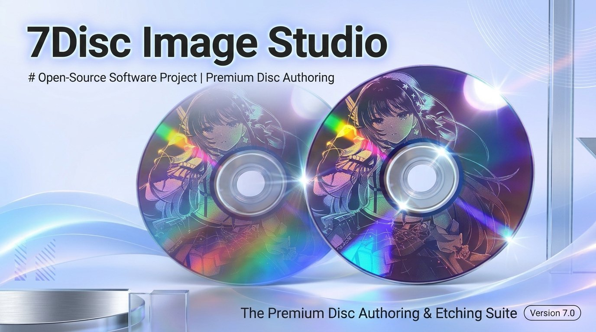
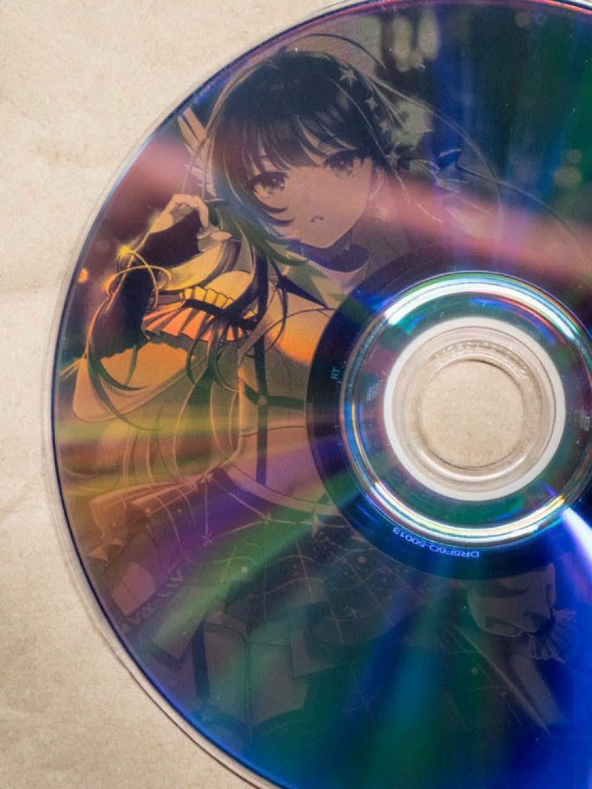
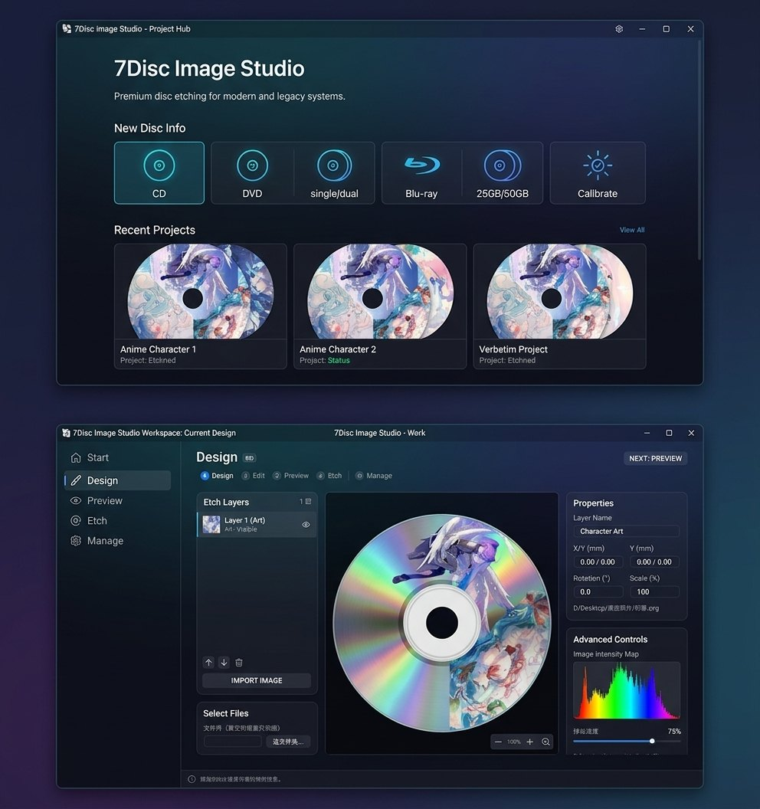
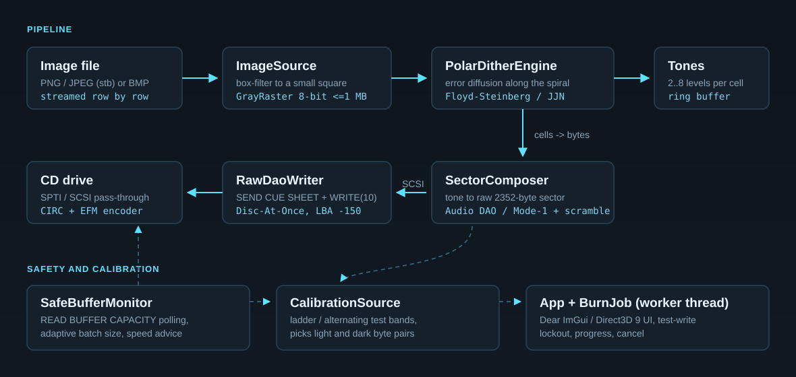

<div align="center">
  
</div>

# 7Disc Image Studio 💿

<div dir="rtl" align="right">

### اسطوانتك بقت لوحة — مش ملصق، حُفَر

استوديو متكامل يستخدم ليزر الحارق قلمًا له: يحوّل صورة عادية إلى رسمة محفورة على ظهر الأسطوانة، دون طابعة، ودون ملصقات، ودون الحاجة إلى محرك LightScribe.

</div>

[](https://github.com/abd77o/DiscImageStudio/releases/latest)
[](https://github.com/abd77o/DiscImageStudio/releases)
[](https://github.com/abd77o/DiscImageStudio/actions/workflows/ci.yml)
[](LICENSE)
[-0078D4.svg)](#download)
[](#features)

<div align="center">

<a href="https://github.com/abd77o/DiscImageStudio/releases/latest/download/DiscImageStudio-win32.exe">
  
</a>
&nbsp;
<a href="https://github.com/abd77o/DiscImageStudio/releases">
  
</a>

</div>

<div dir="rtl" align="right">

**ملف تنفيذي واحد بحجم 610 كيلوبايت · بلا تثبيت · بلا مكتبات خارجية · لا يحتاج إنترنتًا بعد التحميل**

| 1 | 2 | 3 |
|:--:|:--:|:--:|
| **حمّل** ملف `exe` | **شغّله كمسؤول** (Run as administrator) | **اختر صورتك** وابدأ الحرق |

> ### ⚠️ اقرأ هذا أولًا
> البرنامج **تجريبي**، ويكتب على الأسطوانة على مستوى أوامر القيادة الأساسية للحارق، ما يعني أن **الأسطوانة تُستهلك نهائيًا** بعد الكتابة.
> ابدأ بأسطوانة **CD-RW**، وأبقِ خيار **Test write** مُفعّلًا، واقرأ [docs/HARDWARE_NOTES.md](docs/HARDWARE_NOTES.md) قبل استخدام أي أسطوانة تهمّك.
> **Experimental software that permanently destroys the disc it writes to.**

---

## 🎯 لماذا 7Disc؟

- **استوديو نقش، لا مجرّد حارق أسطوانات.** برامج الحرق تكتب ملفات؛ هذا البرنامج يكتب **صورة**. كل تفصيلة تراها على سطح الأسطوانة هي نتيجة قرارات حُفَر اتُّخذت على مستوى القطاع الواحد.
- **أخفّ ما يمكن أن يكون عليه استوديو أقراص.** صفر اعتماديات وقت التشغيل، وملف تنفيذي واحد مرتبط ارتباطًا ساكنًا: لا .NET، ولا حزم إضافية، ولا تثبيت.
- **مصمَّم للأجهزة التي يستخدمها الناس فعلًا.** يعمل على Windows 7 وعلى جهاز بذاكرة 512 ميجابايت؛ ذاكرة توزيع الخطأ في محرك الديثرينج كلها أقل من 1 ميجابايت، والرستر الداخلي لا يتجاوز 1 ميجابايت، مهما كان حجم القرص.
- **يتحدث لغة الحارق مباشرة.** أوامر MMC على مستوى SCSI: `SEND CUE SHEET` و`WRITE(10)` في وضع Disc-At-Once، مع دعم منع انقطاع المخزن المؤقت (buffer underrun)، دون طبقة وسيطة تخفي شيئًا.
- **فلسفة واضحة: لا تُتلف أسطوانتك.** حارس للمخزن المؤقت يقرأ نسبة امتلاء ذاكرة الحارق لحظيًا، ويوسّع الدفعات، ويقترح سرعة أهدأ للمحاولة التالية؛ كما يبقى الحرق الحقيقي مقفلًا حتى ينجح *Test write* مرة واحدة.
- **معايرة على جهازك أنت.** سلّم من 16 نمط بايت يُحرق كحلقات، تختار منه الأفتح والأغمق بعينك، فتُحفظ القيم وتعمل على حارقك ووسطك أنت، لا على افتراضات نظرية.
- **لا ادعاءات بلا دليل.** ثلاث مجموعات اختبار تُشغّل مسار الحرق كاملًا على حارق وهمي، دون أي عتاد، وتعمل على Linux مع كل تعديل.

> **أرقام قابلة للتحقق:** البرنامج كاملًا بحجم **610 كيلوبايت** — أقل من صورة هاتف — و**44 ملف C++** من أصل 76 ملفًا في المستودع، مع **3 مجموعات اختبار** و**صفر** اعتماديات.
>
> **وبصراحة:** الإصدار `0.1.x` بداية قوية لا نهاية؛ مسار الحرق مُتحقَّق منه آليًا على حارق وهمي، والنتائج الحقيقية موثّقة بصور من المؤلف. مصفوفة (حارق × وسيط × سرعة) قيد البناء، وهي أهم ما يمكنك المساهمة به.

---

## 💿 نتائج حقيقية

<div align="center">
  
  <br>
  <sub><b>أسطوانة CD-R محروقة فعليًا — صورة بكاميرا، لا تصميم ببرنامج.</b><br>
  الصورة بأكملها ناتجة من نمط الحُفَر على جهة البيانات: لا ملصق، ولا طباعة، ولا حبر. (تصوير المؤلف <a href="https://github.com/abd77o">@abd77o</a>)</sub>
</div>

---

## 🖥️ الواجهة

<div align="center">
  
  <br>
  <sub><b>التصميم المقترح للواجهة الحديثة</b> — Start / Design / Preview / Etch / Manage.<br>
  أما الواجهة المنفّذة في <code>0.1.x</code> فأبسط من ذلك: نافذة ImGui واحدة تضم تبويب الصورة وتبويب المعايرة وشريط تقدم.</sub>
</div>

---

<a id="features"></a>

## 🛠️ الميزات

- **محرك ديثرينج قطبي (Polar Dithering):** تُقرأ الصورة على امتداد المسار الحلزوني الحقيقي (`r² = r₀² + p·s/π`)، ويُوزَّع الخطأ **في هندسة القرص نفسها**: إلى الخلية التالية على المسار، وإلى الخلية الواقعة على الزاوية نفسها بعد دورة أو أكثر. متاح كيرنلا **Floyd–Steinberg** و**Jarvis–Judice–Ninke**، ومن درجتين إلى 8 درجات.
- **ذاكرة ثابتة:** تُقرأ الصورة سطرًا بسطر وتُختزل إلى رستر مربّع صغير، ويُخزَّن الخطأ في مخزن دائري بمساحة تعادل دورتين تقريبًا؛ فحرق قرص مدته 80 دقيقة لا يحتاج ذاكرة أكبر من حرق قرص مدته 5 دقائق.
- **تحكم كامل في القطاعات:** كل قطاع من **2352 بايتًا** يُبنى داخل البرنامج (تخطيط Audio DAO افتراضيًا، مع مُشوِّش (scrambler) وفق ECMA-130 لتخطيط Mode-1)، فيصل إلى مشفّر CIRC/EFM ما اختاره محرك الديثرينج تحديدًا.
- **مسار حرق MMC كامل:** `SET CD SPEED` ← `MODE SELECT` ← `SEND CUE SHEET` ← `WRITE(10)` من LBA −150 ← `SYNCHRONIZE CACHE`، عبر SPTI مع تفعيل منع انقطاع المخزن المؤقت.
- **حارس المخزن المؤقت:** يقرأ `READ BUFFER CAPACITY` أثناء الحرق، ويوسّع الدفعات عند انخفاض المخزن، ويقترح سرعة أهدأ للمرة التالية بدلًا من إيقاف الحرق في منتصفه.
- **معايرة من 16 خطوة:** سلّم من بايتات مرشّحة يُحرق كحلقات متتابعة، تختار منه الأفتح والأغمق لحارقك ووسطك، وتُحفظ القيمة في `config.ini`.
- **حواجز أمان:** الحرق الحقيقي مقفل حتى ينجح *Test write* مرة واحدة، والإلغاء ينبّه إلى أن وضع DAO لا يقبل الاستكمال.
- **اختبارات بلا عتاد:** المحرك، وبناء القطاعات، وكل أوامر MMC، وحارس المخزن المؤقت، وتنظيم الحرق بأكمله تُختبر على حارق وهمي.

---

## ⚙️ كيف يعمل

<div align="center">
  
</div>

1. **من الصورة إلى رستر رمادي.** يقرأ `ImageSource` الملف سطرًا بسطر (PNG/JPEG عبر `stb_image`، وBMP أصلًا) ويختزله إلى رستر مربّع بدرجة 8-بت وحجم لا يتجاوز 1024 × 1024.
2. **من الرستر إلى الدرجات.** يمشي `PolarDitherEngine` على الحلزون خليةً خلية (196 بايتًا للخلية، و12 خلية في القطاع، أي نحو 1.33 مم من المسار). تُقرأ كل خلية عند (نصف قطر، زاوية) الحقيقيين، وتُكمَّم، فينتقل الخطأ إلى الجيران **على القرص**؛ ولذلك تتبع الحبيبات المسار، لا حدود الشاشة.
3. **من الدرجات إلى القطاعات.** يحوّل `SectorComposer` كل درجة إلى قطاع خام من 2352 بايتًا. وفي Audio DAO لا يوجد تشويش ولا EDC/ECC، فتصل البايتات كاملة إلى المشفّر كما هي.
4. **من القطاعات إلى الحارق.** ينفّذ `RawDaoWriter` تسلسل أوامر MMC السابق، ويغذّيه `SafeBufferMonitor`، وتعود إلى الواجهة نسبة التقدم، وحالة المخزن، والسرعة المقترحة.

التفاصيل الأعمق في [docs/ARCHITECTURE.md](docs/ARCHITECTURE.md).

---

<a id="download"></a>

## ⬇️ التحميل والتثبيت

### الطريقة الأسهل: ملف تنفيذي جاهز

<div align="center">

**[⬇️ حمّل `DiscImageStudio-win32.exe` من صفحة الإصدارات](https://github.com/abd77o/DiscImageStudio/releases/latest)**

</div>

| الخطوة | ما تفعله |
|:--:|---|
| 1 | نزّل الملف `DiscImageStudio-win32.exe`، ومعه ملف `.sha256` للتحقق من سلامة التنزيل |
| 2 | ضعه في أي مجلد — **لا تثبيت، ولا Setup، ولا تعديل على سجل النظام** |
| 3 | انقر عليه بزر الفأرة الأيمن ثم اختر **Run as administrator** (إلزامي، لأن الكتابة على الحارق تتطلب صلاحية مدير) |
| 4 | إن ظهر تحذير Windows: **More info** ← **Run anyway** (البرنامج غير موقّع بشهادة مدفوعة) |

### التحقق من سلامة الملف (اختياري)

```powershell
Get-FileHash .\DiscImageStudio-win32.exe -Algorithm SHA256
# ثم قارن الناتج بملف DiscImageStudio-win32.exe.sha256 من صفحة الإصدار نفسها
```

### أو ابنِه بنفسك من المصدر

```bat
git clone https://github.com/abd77o/DiscImageStudio.git
cd DiscImageStudio
scripts\fetch_deps.bat       :: Dear ImGui + stb_image
build_vs2017.bat             :: -> build\Release\DiscImageStudio.exe
```

أو عبر CMake مباشرةً: `cmake -S . -B build -A Win32 -T v141_xp` ثم `cmake --build build --config Release`.

<details>
<summary><strong>Linux / macOS — للاختبارات فقط (بلا واجهة وبلا حارق)</strong></summary>

```bash
cmake -S . -B build -DCMAKE_BUILD_TYPE=Release
cmake --build build -j
ctest --test-dir build --output-on-failure
```

</details>

---

## 💻 المتطلبات

| البند | التفاصيل |
|---|---|
| **نظام التشغيل** | Windows 7 SP1 أو أحدث؛ بناء x86 الساكن يعمل على 64-بت أيضًا (الكود مصمم ومُهندَس لـ 7 حتى 11) |
| **الذاكرة** | أي مقدار؛ البرنامج يعمل في حدود ميغابايتات، ومصمم لأجهزة 512 ميجابايت |
| **العتاد** | حارق **CD-R / CD-RW** يدعم الكتابة الخام Disc-At-Once. **أقراص CD فقط**، فمعظم حوارق DVD لا تدعم raw DAO |
| **الصور** | PNG / JPEG / BMP |
| **الصلاحيات** | Administrator (إلزامية للكتابة على الحارق) |
| **الإنترنت** | غير مطلوب بعد التحميل |

---

## 🚀 الاستخدام

1. شغّل البرنامج **كمسؤول**، واختر الحارق وسرعة منخفضة (**4×** بداية آمنة).
2. **تبويب المعايرة:** احرق السلّم على أسطوانة CD-RW، ثم انظر إلى الأسطوانة وسجّل النطاق الأفتح والأغمق؛ تُحفظ القيم في `config.ini`.
3. **تبويب الصورة:** حمّل صورتك، واضبط السطوع والتباين وجاما والدوران ونصف قطر الصورة، وراجع المعاينة. أبقِ **Test write** مُفعّلًا حتى ينجح مرة.
4. **الحرق:** تظهر نسبة التقدم وحالة المخزن والسرعة المقترحة مباشرةً. **إلغاء حرق حقيقي يعني إتلاف الأسطوانة**، لأن Disc-At-Once لا يقبل الاستكمال.

---

## 🛡️ السلامة وحدود العتاد

- **أقراص CD فقط.** يرفض فحص ما قبل الحرق أي وسيط غير CD.
- **الحرق يُتلف الأسطوانة.** ابدأ بأسطوانة CD-RW.
- **الدقة محدودة بطبيعة الوسيط:** الخلايا بنحو 1.3 مم على المسار و1.6 ميكرومتر عبره، ويمدّ المشفّر البيانات على قطاع كامل؛ توقّع تدرّجًا ناعمًا في الاتجاه الشعاعي وتفاصيل أقل في الاتجاه المماسي.
- **Test write** غير مدعوم في حوارق حديثة كثيرة؛ فإن رفضه حارقك، جرّب على CD-RW ثم سجّل `test_write_passed=1` في `config.ini`.
- القائمة الكاملة: [docs/HARDWARE_NOTES.md](docs/HARDWARE_NOTES.md).

---

## 📁 بنية المشروع

| المسار | المحتوى |
|---|---|
| `src/core` | هندسة القرص، تحميل الصور بالبث، محرك الديثرينج القطبي، `config.ini` |
| `src/burn` | المُشوِّش (scrambler)، بناء القطاعات، أوامر MMC، ورقة CUE، حارس المخزن، كاتب DAO، جهاز SPTI |
| `src/calib` | مصادر المعايرة (سلّم، ونطاقات متبادلة) |
| `src/gui` | خيط الحرق، منطق واجهة ImGui، مضيف Win32 وDirect3D 9 |
| `tests` | اختبارات الحارق الوهمي (المنطق، الواجهة، الحرق الكامل) |
| `tools` | `dither_preview` — معاينة بلا واجهة |
| `scripts` · `docs` | تحميل الاعتماديات · المعمارية والبناء وملاحظات العتاد |

---

## 🧪 الاختبارات والتكامل المستمر

```bash
cmake -S . -B build -DCMAKE_BUILD_TYPE=Release && cmake --build build -j
ctest --test-dir build --output-on-failure
```

ثلاث مجموعات: `test_burn_logic` (المُشوِّش، بناء القطاعات، كل أوامر CDB، حارس المخزن، سيناريوهات الحرق)، و`test_gui_logic` (الإعدادات، القص، دورة حياة المهمة، الإلغاء، قفل الحرق)، و`test_image_burn` (من BMP حتى الكاتب على حارق وهمي). لا شيء منها يحتاج حارقًا ولا أسطوانة ولا صلاحية مدير.

يشغّل GitHub Actions الاختبارات على Linux (GCC وClang)، ويبني الواجهة على Windows؛ وكل وسم (tag) يُنتج **إصدارًا منشورًا** يضم `DiscImageStudio-win32.exe` وملف التحقق.

---

## 🗺️ خارطة الطريق

- [ ] **الواجهة الحديثة** كما في التصميم المقترح (Start / Design / Preview / Etch / Manage، مع الوضع الداكن)
- [ ] مصفوفة تحقق على عتاد حقيقي (حارق × وسيط × سرعة) مع قالب تقرير جاهز
- [ ] معايرة آلية (قراءة السلّم بالفحص بدلًا من العين)
- [ ] تعويض مسبق لتشويش CIRC لزيادة حِدّة الصورة
- [ ] وضع سطر أوامر لحرق مجموعة تصاميم دفعة واحدة
- [ ] التحقق من ثوابت Mode-1 في ورقة CUE (`kFormDataRaw`, `kFormLeadData`) مقابل MMC

---

## 🤝 المساهمة

أهم مساهمة ممكنة اليوم هي **تقرير عتاد**: طراز الحارق، وإصدار البرنامج الثابت، ونوع الأسطوانة، والسرعة، والنتيجة، وصورة للأسطوانة. اقرأ [CONTRIBUTING.md](CONTRIBUTING.md) و[CODE_OF_CONDUCT.md](CODE_OF_CONDUCT.md).

- 🐞 [أبلغ عن مشكلة](../../issues/new/choose) · 🔐 [سياسة الأمان](SECURITY.md) · 📋 [سجل التغييرات](CHANGELOG.md)

---

## 📄 الرخصة

[MIT](LICENSE) © 2026 **abd77o**.

مكونات الطرف الثالث: **Dear ImGui** (MIT) و**stb_image** (ملكية عامة / MIT)، تُحمَّل وقت البناء ولا تُرفع إلى المستودع.

## 📬 التواصل

- GitHub: [@abd77o](https://github.com/abd77o) · البريد: [poi99poin@gmail.com](mailto:poi99poin@gmail.com)
- الإصدارات: [github.com/abd77o/DiscImageStudio/releases](https://github.com/abd77o/DiscImageStudio/releases)

</div>

---

## English overview

**7Disc Image Studio** draws a picture into the **data side of a CD-R** using the disc's own pit pattern — no label, no printer, no LightScribe drive. The laser is the pen.

- **One static `.exe` (610 KB), zero runtime dependencies**, Dear ImGui + Direct3D 9 — runs on Windows 7 through 11, engineered for 512 MB machines. No installer, no redistributable, no network needed after download.
- **Polar dithering engine:** the image is sampled along the real spiral and the error is diffused in disc geometry (next cell on the track, same angle on following revolutions). Floyd–Steinberg / Jarvis–Judice–Ninke kernels, 2–8 tones, constant memory.
- **Raw sector control:** hand-composed 2352-byte sectors (Audio DAO by default, ECMA-130 scrambler for Mode-1).
- **Full MMC burn path:** `SET CD SPEED` → `MODE SELECT` → `SEND CUE SHEET` → `WRITE(10)` from LBA −150 → `SYNCHRONIZE CACHE`, over SPTI, with buffer-underrun-free recording and a `READ BUFFER CAPACITY` watchdog.
- **16-step calibration ladder** to find the lightest and darkest tone pair for your drive and media.
- **Three hardware-free test suites** run against a mock drive on every push (Linux, GCC + Clang), plus a Windows build and a published release on every tag.

**Download:** [latest `DiscImageStudio-win32.exe`](https://github.com/abd77o/DiscImageStudio/releases/latest) and run it as Administrator.
**Status: experimental** — it permanently destroys the disc it writes to, so start with a CD-RW and read
[docs/HARDWARE_NOTES.md](docs/HARDWARE_NOTES.md). Licensed under [MIT](LICENSE).
