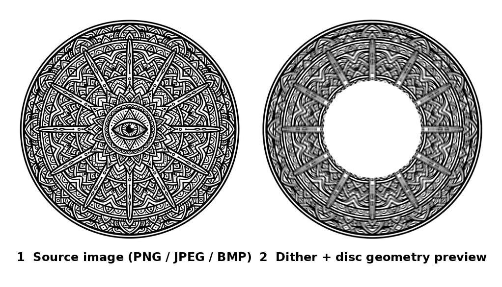
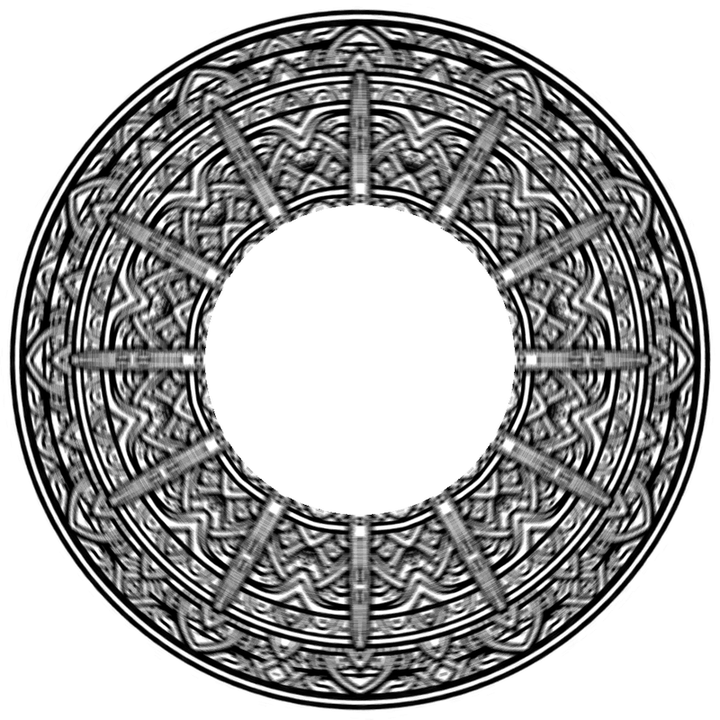

<div align="center">
  
</div>

# 7Disc Image Studio · `DiscImageStudio`

**ارسم صورة على ظهر الأسطوانة (الجهة البيانات) بنمط الحُفَر نفسه — بدون ملصقات، وبدون طابعة، وبدون LightScribe.**

[](https://github.com/abd77o/DiscImageStudio/actions/workflows/ci.yml)
[](LICENSE)
[](CMakeLists.txt)
[-0078D4.svg)](#-المتطلبات--requirements)
[](docs/HARDWARE_NOTES.md)
[](tests)

> ### ⚠️ اقرأ ده الأول / Read this first
> **الأداة تجريبية** وبتكتب على القرص على مستوى SCSI/MMC، و**بتتلف الأسطوانة اللي بتتكتب عليها**.
> ابدأ بـ **CD-RW**، وسيب خيار *Test write* مفعّل، واقرأ [docs/HARDWARE_NOTES.md](docs/HARDWARE_NOTES.md) قبل أي أسطوانة تفرق معاك.
> **Experimental software that permanently destroys the disc it writes to. Start with a CD-RW and read the hardware notes.**

---

## المحتويات / Table of contents

| | |
|---|---|
| [الفكرة](#-الفكرة--why) | لماذا المشروع موجود |
| [نتائج حقيقية](#-نتائج-حقيقية--real-results) | صورة أسطوانة محروقة فعليًا |
| [الصور](#-الواجهة--screenshots) | الواجهة والتصميم المقترح |
| [الميزات](#-الميزات--features) | ما تفعله الأداة |
| [كيف يعمل](#-كيف-يعمل--how-it-works) | من الصورة إلى الحُفَر |
| [المتطلبات](#-المتطلبات--requirements) · [البناء](#-البناء--build) · [الاستخدام](#-الاستخدام--usage) | للبدء |
| [السلامة](#-السلامة-وحدود-الهاردوير--safety) · [هيكل المشروع](#-هيكل-المشروع--layout) · [الاختبارات](#-الاختبارات-و-ci--tests) | للمطوّرين |
| [خارطة الطريق](#-خارطة-الطريق--roadmap) · [المساهمة](#-المساهمة--contributing) · [الرخصة](#-الرخصة--license) | |
| [English](#english-overview) | نظرة سريعة بالإنجليزية |

---

## ✨ الفكرة / Why

الأجهزة القديمة والضعيفة هي أكتر حاجة عندها محركات أقراص CD/DVD، وأقل حاجة بتهتم بيها البرمجيات الحديثة.
**7Disc Image Studio** مشروع مفتوح المصدر بياخد صورة عادية ويحوّلها لرسمة محفورة على ظهر الأسطوانة:
الصورة بتتحوّل لنمط من الحُفَر، والحُفَر دي هي اللي بتعمل الإضاءة والظل اللي تشوفه بعينك.

كل ده في **C++11 بدون أي اعتماديات وقت التشغيل**: ملف `.exe` واحد static، بواجهة Dear ImGui
على Direct3D 9، يشتغل على Windows 7 وعلى جهاز ضعيف الذاكرة. حاسبة الخطأ للصور تفضل تحت **1 ميجابايت**،
والرستر الداخلي ≤ **1 ميجابايت** (1024 × 1024)، مهما كان حجم القرص.

> **بصراحة:** الإصدار الحالي (`v0.1.0`) هو الأساس الكلاسيكي الخفيف — كود واحد، نافذة واحدة، بدون أي حزم إضافية.
> الواجهة الحديثة اللي في الصور تحت هي **تصميم مقترح على خارطة الطريق**، مش منفّذة بعد.

---

## 💿 نتائج حقيقية / Real results

<div align="center">
  
  <br>
  <sub><b>أسطوانة CD-R محروقة فعليًا</b> — الصورة كلها ناتجة من نمط الحُفَر على الجهة البيانات، مفيش ملصق ولا طباعة. (صورة من المؤلف <a href="https://github.com/abd77o">@abd77o</a>)</sub>
</div>

وشكل الصورة على القرص قبل الحرق — دي صورة **حقيقية** مولّدة بالكود الموجود في الريبو (`tools/dither_preview`)،
مش رسم توضيحي:

<table>
<tr>
<td width="50%"></td>
<td width="50%"></td>
</tr>
<tr>
<td align="center"><sub>الصورة الأصلية ← شكلها بعد الديثرينج على القرص</sub></td>
<td align="center"><sub>Floyd–Steinberg بلونين، خلايا 1.33 مم، مساحة 58 مم</sub></td>
</tr>
</table>

```console
$ ./dither_preview artwork.bmp disc.pgm 196 2 fs
cells=4033510 sectors=336125 cellLen=1.333mm
```

---

## 🖥️ الواجهة / Screenshots

<div align="center">
  
  <br>
  <sub><b>تصميم مقترح (Concept) للواجهة الحديثة</b> — Start / Design / Preview / Etch / Manage.
  الواجهة المنفّذة حاليًا أبسط من كده بكثير: نافذة ImGui واحدة فيها تبويب الصورة وتبويب المعايرة وشريط التقدم.</sub>
</div>

---

## 🛠️ الميزات / Features

- **محرك ديثرينج قطبي (Polar Dithering):** الصورة بتُقرأ على طول المسار الحلزوني الحقيقي (`r² = r₀² + p·s/π`)،
  وتوزيع الخطأ بيحصل **في هندسة القرص**: للخلية اللي بعدها على المسار، وللخلية اللي على نفس الزاوية بعد دورة أو أكتر.
  كيرنليز Floyd–Steinberg و Jarvis–Judice–Ninke، من 2 لـ 8 درجات.
- **ذاكرة ثابتة:** الصورة تُقرأ سطر بسطر وتُختصر لرستر مربّع صغير، والخطأ بيتخزن في ring buffer بمساحة ~دورتين —
  يعني حرق قرص 80 دقيقة مش محتاج رام زيادة.
- **تحكم كامل في القطاعات:** كل قطاع 2352 بايت بيتكوّن بإيد الأداة (تخطيط Audio DAO افتراضيًا، ومعاه
  scrambler بتاع ECMA-130 لتخطيط Mode-1)، فاللي بيوصل لمشفر CIRC/EFM هو اللي اختاره الديثرينج بالظبط.
- **حارق MMC:** `SET CD SPEED` → `MODE SELECT` → `SEND CUE SHEET` → `WRITE(10)` من LBA −150 →
  `SYNCHRONIZE CACHE`، عبر SPTI مع تفعيل منع buffer-underrun.
- **حارس البَفر:** بيقرأ `READ BUFFER CAPACITY` أثناء الحرق، يكبّر الدفعات لو البَفر نزل، ويقترح سرعة أقل للمرة الجاية
  بدل ما يوقف الحرق.
- **المعايرة:** سلّم من 16 بايت مرشّح بيتحرق كحلقات، تختار منه الأفتح والأغمق لدرايفك وأسطواناتك، والنتيجة تتحفظ في `config.ini`.
- **حواجز أمان:** الحرق الحقيقي مقفول لحد ما *Test write* ينجح مرة، والإلغاء بينبّه إن DAO مش قابل للاستكمال.
- **اختبارات بدون هاردوير:** المحرك، تركيب القطاعات، أوامر MMC، حارس البَفر، وكل تنظيم الحرق بيتستوا ضد درايف وهمي (mock).

---

## ⚙️ كيف يعمل / How it works

<div align="center">
  
</div>

1. **صورة ← رستر رمادي.** `ImageSource` بيقرأ الملف سطر بسطر ويختزله لرستر مربّع 8-bit (≤ 1024 × 1024).
   PNG/JPEG من `stb_image`، و BMP أصلي.
2. **رستر ← درجات.** `PolarDitherEngine` بيمشي على الحلزون خلية خلية (196 بايت للخلية، 12 خلية في القطاع،
   ≈1.33 مم طول مسار). كل خلية بتُقرأ عند (نصف قطر، زاوية) الحقيقيين، وتتكمّم، والخطأ يروح للجيران
   **على القرص** — وعشان كده الحبيبات بتمشي مع المسار مش مع حدود الشاشة.
3. **درجات ← قطاعات.** `SectorComposer` بيحوّل كل درجة لقطاع خام 2352 بايت. في Audio DAO مفيش scramble
   ومفيش EDC/ECC، فالـ 2352 بايت كلها بتوصل للمشفّر زي ما هي.
4. **قطاعات ← درايف.** `RawDaoWriter` بينفّذ تسلسل MMC اللي فوق، و`SafeBufferMonitor` بيغذّيه، والتقدم
   والبَفر والسرعة المقترحة بترجع للواجهة.

تفاصيل أعمق (الحدود بين الوحدات، الـ invariants، وليه Audio DAO هو الافتراضي) في
[docs/ARCHITECTURE.md](docs/ARCHITECTURE.md).

---

## 💻 المتطلبات / Requirements

| | للبناء (Build) | للتشغيل (Run) |
|---|---|---|
| النظام | Windows 7 SP1 أو أحدث (بناء x86 بيشتغل على x64) — أو Linux/macOS للاختبارات بس | نفس الحاجة |
| المترجم | Visual Studio 2017+ (`v141_xp` لتوافق Windows 7) | — |
| أدوات | CMake ≥ 3.5 + git | صلاحيات **Administrator** (SPTI) |
| طرف ثالث | Dear ImGui 1.90.9 (MIT) + `stb_image.h` — بيتحمّلوا بسكربت، مش مرفوعين | — |
| الهاردوير | — | حارق CD-R/CD-RW يدعم raw Disc-At-Once · **CD فقط** (مفيش raw DAO على معظم حوارق DVD) |

---

## 🔨 البناء / Build

```bat
git clone https://github.com/abd77o/DiscImageStudio.git
cd DiscImageStudio

scripts\fetch_deps.bat       :: Dear ImGui + stb_image -> third_party\
build_vs2017.bat             :: -> build\Release\DiscImageStudio.exe
```

أو بـ CMake مباشرة:

```bat
cmake -S . -B build -A Win32 -T v141_xp
cmake --build build --config Release
```

<details>
<summary><strong>Linux / macOS — للاختبارات فقط (بدون واجهة وبدون حارق)</strong></summary>

```bash
cmake -S . -B build -DCMAKE_BUILD_TYPE=Release
cmake --build build -j
ctest --test-dir build --output-on-failure
```

لو `third_party/stb` مش موجود، البناء بيكمل بدون PNG/JPEG (BMP بس). لو `third_party/imgui` مش موجود،
هدف الواجهة بيتخطى. تفاصيل التولشين و DirectX SDK في [docs/BUILDING.md](docs/BUILDING.md).
</details>

---

## 🚀 الاستخدام / Usage

1. شغّل `DiscImageStudio.exe` **كـ Administrator**، اختار الحارق وسرعة منخفضة (4× بداية آمنة).
2. **تبويب المعايرة:** احرق السلّم على CD-RW، بص على الأسطوانة، سجّل الباند الأفتح والأغمق. القيم تتحفظ في `config.ini`.
3. **تبويب الصورة:** حمّل PNG/JPG/BMP، ظبّط السطوع/التباين/جاما والدوران ونصف قطر الصورة، وشوف المعاينة.
   سيب **Test write** مفعّل لحد ما ينجح مرة.
4. **Burn:** التقدم ونسبة البَفر وسرعة المرة الجاية ظاهرين لايف. **إلغاء حرق حقيقي = تلقيح الأسطوانة**
   (Disc-At-Once مش بيتكمل).

---

## 🛡️ السلامة وحدود الهاردوير / Safety

- **CD فقط.** معظم حوارق DVD ملهاش وضع raw DAO، والـ preflight بيرفض أي ميديا غير CD.
- **الحرق بيلغي الأسطوانة.** جرّب على CD-RW الأول.
- **الدقة محدودة بطبيعتها:** الخلايا ≈1.3 مم على المسار و1.6 µm عبره، والمشفّر بيمد البيانات على قطاع كامل —
  توقّع تدرّج ناعم في الاتجاه الشعاعي وتفاصيل أقل في الاتجاه المماسي.
- **Test write** مش مدعوم في حوارق حديثة كتير؛ لو درايفك رفضه، جرّب على CD-RW وسجّل `test_write_passed=1` في `config.ini`.
- القائمة الكاملة: [docs/HARDWARE_NOTES.md](docs/HARDWARE_NOTES.md).

---

## 📁 هيكل المشروع / Layout

| المسار | إيه فيه |
|---|---|
| `src/core` | هندسة القرص، تحميل الصور بالبث، محرك الديثرينج القطبي، `config.ini` |
| `src/burn` | scrambler، تركيب القطاعات، أوامر MMC، CUE sheet، حارس البَفر، كاتب DAO، جهاز SPTI |
| `src/calib` | مصادر المعايرة (سلّم / باندات متبادلة) |
| `src/gui` | خيط الحرق، منطق واجهة ImGui، مضيف Win32 + Direct3D 9 |
| `tests` | اختبارات الدرايف الوهمي (logic / gui / end-to-end) |
| `tools` | `dither_preview` — معاينة بدون واجهة |
| `scripts` · `docs` | تحميل الاعتماديات · المعمارية والبناء وملاحظات الهاردوير |

---

## 🧪 الاختبارات و CI / Tests

```bash
cmake -S . -B build -DCMAKE_BUILD_TYPE=Release && cmake --build build -j
ctest --test-dir build --output-on-failure
```

تلات مجموعات: `test_burn_logic` (scrambler، تركيب القطاعات، كل CDB، حارس البَفر، سيناريوهات الحرق)،
`test_gui_logic` (الإعدادات، القص، دورة حياة المهمة، الإلغاء، قفل الحرق)، و`test_image_burn` (من BMP
لحد الكاتب على درايف وهمي). مفيش حاجة محتاجة حارق ولا أسطوانة ولا أدمن.

GitHub Actions بيشغّل الاختبارات على Linux (GCC + Clang) وبيبني الواجهة على Windows وينزّل الـ `.exe` كـ artifact؛
وأي tag بيطلع Release فيه الـ zip + SHA256.

---

## 🗺️ خارطة الطريق / Roadmap

- [ ] **الواجهة الحديثة** زي التصميم المقترح (Start / Design / Preview / Etch / Manage + الوضع الداكن)
- [ ] مصفوفة تحقق على هاردوير حقيقي (درايف × ميديا × سرعة) + قالب تقرير جاهز
- [ ] معايرة أوتوماتيكية (قراءة السلّم بالفحص بدل العين)
- [ ] تعويض مسبق لتشويش CIRC لزيادة حِدّة الصورة
- [ ] وضع سطر أوامر لحرق مجموعة تصاميم دفعة واحدة
- [ ] التحقق من ثوابت Mode-1 في الـ CUE sheet (`kFormDataRaw`, `kFormLeadData`) ضد MMC

---

## 🤝 المساهمة / Contributing

أهم مساهمة ممكن تقدّمها دلوقتي هي **تقرير هاردوير**: موديل الدرايف، الفيرموير، نوع الأسطوانة، السرعة، والنتيجة
وصورة للأسطوانة. اقرأ [CONTRIBUTING.md](CONTRIBUTING.md) و[CODE_OF_CONDUCT.md](CODE_OF_CONDUCT.md)،
وخلي قاعدة **الاختبارات بتشتغل على Linux** سليمة: الكود فوق طبقة SCSI لازم يفضل مستقل عن المنصة.

- 🐞 [بلّغ عن مشكلة](../../issues/new/choose) · 🔐 [سياسة الأمان](SECURITY.md) · 📋 [سجل التغييرات](CHANGELOG.md)

---

## 📄 الرخصة / License

[MIT](LICENSE) © 2026 **abd77o**.
طرف ثالث: **Dear ImGui** (MIT) و **stb_image** (public domain / MIT) — بيتحمّلوا وقت البناء ومش مرفوعين في الريبو.
شوف [third_party/README.md](third_party/README.md).

## 📬 التواصل / Contact

- GitHub: [@abd77o](https://github.com/abd77o)
- Email: [poi99poin@gmail.com](mailto:poi99poin@gmail.com)
- Releases: [github.com/abd77o/DiscImageStudio/releases](https://github.com/abd77o/DiscImageStudio/releases)

---

## English overview

**7Disc Image Studio** draws an image into the **data side of a CD-R** using the disc's own pit pattern — no
label, no printer, no LightScribe drive. C++11, no runtime dependencies, one statically linked `.exe`
(Dear ImGui + Direct3D 9) that runs on Windows 7 and on weak hardware.

- **Polar dithering engine:** samples the image along the real spiral and error-diffuses in disc geometry
  (next cell on the track, same angle on following revolutions). Floyd–Steinberg / Jarvis–Judice–Ninke, 2–8 tones.
- **Constant memory:** streamed image loading plus a ring buffer of about two revolutions — well under 1 MB.
- **Raw sector control:** hand-composed 2352-byte sectors (Audio DAO by default, ECMA-130 scrambler for Mode-1).
- **MMC burner:** `SET CD SPEED` → `MODE SELECT` → `SEND CUE SHEET` → `WRITE(10)` from LBA −150 →
  `SYNCHRONIZE CACHE`, over SPTI, with buffer-underrun-free recording and a `READ BUFFER CAPACITY` watchdog.
- **Calibration ladder** to find the lightest/darkest tone pair for your drive and media, saved to `config.ini`.
- **Hardware-free tests:** three suites run against a mock drive on Linux — no burner, disc or admin rights.

```bat
scripts\fetch_deps.bat
build_vs2017.bat            :: -> build\Release\DiscImageStudio.exe
```

**Status: experimental.** The burn path destroys the disc it writes to; start with a CD-RW and read
[docs/HARDWARE_NOTES.md](docs/HARDWARE_NOTES.md). Licensed under [MIT](LICENSE).
